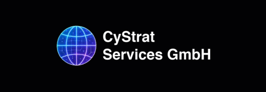
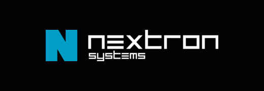
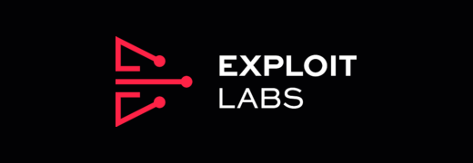

<p align="center">
  <a href="https://www.cystrat-services.com/"></a>
  <a href="https://www.nextron-systems.com/"></a>
  <a href="https://xplt.com/"></a>
</p>

<h1 align="center">Hermes Agentic SOC</h1>

<p align="center"><strong>Cybersecurity from Germany. For the world.</strong></p>

<p align="center">
  <a href="plugin.yaml"></a>
  <a href="docs/GETTING-STARTED.md#prerequisites"></a>
  <a href="docs/GETTING-STARTED.md#install-in-hermes"></a>
</p>
<p align="center">
  <a href="#license-and-release-status"></a>
  <a href="docs/INTEGRATION-ROADMAP.md"></a>
  <a href="LICENSE"></a>
</p>

<p align="center">
  <a href="https://www.cystrat-services.com/">CyStrat Services</a> ·
  <a href="https://www.nextron-systems.com/">Nextron Systems</a> ·
  <a href="https://xplt.com/">exploit labs</a>
</p>

When agentic AI goes on the offensive, defenders need more than another chatbot. They need cybersecurity expertise that can work with their evidence, their tools and their operational boundaries.

Hermes Agentic SOC brings that expertise into Hermes through specialist profiles, reusable skills, native tools and structured workflow references. Developed in the CyStrat Services × Nextron Systems project, it starts with evidence-led triage and deterministic THOR assessment. The roadmap extends that foundation toward approved, read-only access to your wider security stack.

<p align="center">
  <a href="docs/README.md">Documentation</a> ·
  <a href="docs/GETTING-STARTED.md">Quickstart</a> ·
  <a href="docs/CAPABILITIES.md">Capabilities</a> ·
  <a href="docs/INTEGRATION-ROADMAP.md">Integration roadmap</a> ·
  <a href="SECURITY.md">Security</a> ·
  <a href="README.de.md">Deutsch</a>
</p>

<p align="center">
  <a href="docs/CAPABILITIES.md"><code>Agentic SOC</code></a> ·
  <a href="docs/OPERATOR-GUIDE.md#assessment-policy"><code>DFIR</code></a> ·
  <a href="docs/OPERATOR-GUIDE.md#tools-and-profiles"><code>Threat Hunting</code></a> ·
  <a href="docs/INTEGRATION-ROADMAP.md"><code>Detection Engineering</code></a> ·
  <a href="docs/CYSTRAT-SOC-SUITE.md"><code>Skills &amp; MCP</code></a> ·
  <a href="SECURITY.md"><code>Human Approval</code></a>
</p>

> [!IMPORTANT]
> **Private development preview · v0.2.3.** Local evidence analysis is implemented; the 25 technology integrations are planning scaffolds, not live connectors. Offensive research is **planned for a later release and not part of this version** — no profile, skill, workflow, tool or switch exists for it. Licensed under Apache-2.0.

## Explore the project

| Evaluate | Operate | Build |
|---|---|---|
| [Current capabilities](#what-you-can-use-today) | [Offline quickstart](#start-with-evidence-not-credentials) | [Architecture](docs/ARCHITECTURE.md) |
| [THOR analysis suite](docs/THOR-ANALYSIS.md) | [THOR worked example](skills/thor-assessment/references/worked-example.md) | [Skill sources](skills/) |
| [Integration roadmap](#one-agent-your-wider-security-stack) | [Operator guide](docs/OPERATOR-GUIDE.md) | [Contributing](CONTRIBUTING.md) |
| [Companies and expertise](#different-strengths-one-mission) | [Security model](SECURITY.md) | [Validation and test limits](docs/VALIDATION.md) |

## Your environment. Our expertise.

The goal is not to replace your security stack. It is to give Hermes a disciplined way to work with it: understand the evidence, apply specialist knowledge, make uncertainty visible and leave consequential decisions with your team.

- **Evidence before conclusions:** Exact event inventories, conservative same-artifact grouping and traceable first assessments instead of model-invented incident narratives.
- **Specialists for the task:** Six defense personas cover triage, incident response, hunting, DFIR, detection engineering and vulnerability management.
- **Reusable operational knowledge:** 39 shipped skills: a nine-skill [THOR analysis suite](docs/THOR-ANALYSIS.md), six domain/workflow skills and 25 technology-specific planning scaffolds.
- **Control by design:** Local evidence boundaries, metadata-only audit records and Hermes-owned approval for sensitive execution. No plugin telemetry, self-updater or hidden LLM calls.

The assessment engine is deterministic. Hermes may use its configured model to interpret tool output, but the plugin does not call a model to calculate severity.

## What you can use today

| Area | Delivered in v0.2.3 | Boundary |
|---|---|---|
| Native Hermes plugin | 7 tools, 4 slash commands, 1 approval-policy hook | Public plugin APIs; no monkey-patching |
| Evidence analysis | THOR JSON v1/v2, arrays, event wrappers and NDJSON | No v3 or legacy CSV/text support |
| First assessment | Exact counts, observation groups, German case JSON/Markdown | Provisional triage, not proof of compromise |
| THOR analysis suite | 9 skills: module and signature interpretation, false-positive review, correlation and timeline, fleet triage, safe IOC handling, SIEM-export intake | Analyst guidance on top of the deterministic tools; [details](docs/THOR-ANALYSIS.md) |
| Local THOR launcher | Fixed-argument FileScan preparation and execution path | External licensed binary and human approval required; real vendor scan not validated here |
| Specialist profiles | 6 defense profiles | Offensive/research roles are planned for a later release and not shipped |
| Workflow references | 4 declarative workflow definitions | Not an executable workflow engine |
| Technology coverage | 25 skills and inactive MCP descriptors | **0 verified live remote connectors** |

The [validation record](docs/VALIDATION.md) distinguishes executed tests from untested scenarios. The [operator guide](docs/OPERATOR-GUIDE.md) documents the detailed approval, privacy and host-isolation limitations.

## Start with evidence, not credentials

Run the synthetic demonstration with Python 3.11 or newer. It requires no THOR installation, provider key or remote connection.

```bash
git clone https://github.com/CyStrat-Services-GmbH/hermes-agentic-soc.git
cd hermes-agentic-soc
python -m agentic_soc demo --output /tmp/hermes-agentic-soc-demo
```

The repository is private, so cloning requires authorized GitHub access. The fixture contains no malware and produces exactly **4 source events → 3 observation groups**, not three proven incidents.

Inspect the delivered scope without contacting a vendor:

```bash
python -m agentic_soc capabilities
python -m agentic_soc capabilities --technology cystrat-soc-suite
python -m agentic_soc profiles
```

For native installation, evidence-root configuration and approval boundaries, follow the [quickstart](docs/GETTING-STARTED.md). For real evidence, use the [operator guide](docs/OPERATOR-GUIDE.md) and your organization's handling policy.

## One agent. Your wider security stack.

The planned integration layer is designed to bring approved security context into Hermes without silently granting write access. Every entry below has a shipped planning skill and an inactive MCP descriptor: 24 technology scaffolds across six domains, plus the cross-domain CyStrat SOC Suite — 25 in total, and none is a production connector in this release.

**Cross-domain platform — CyStrat SOC Suite.** The Suite is not a seventh domain: its modules cover all six domains below. Intended value is tenant- and case-scoped analysis with provenance back to the source system, under a proposed read-only MCP contract.

| Domain | Planned technology coverage | Intended value |
|---|---|---|
| SIEM | Microsoft Sentinel, Splunk, Elastic Security, IBM QRadar, Google SecOps, Wazuh, Graylog | Bounded alert and log investigation |
| SOAR / cases | TheHive / Cortex, Shuffle, Cortex XSOAR, Sentinel Playbooks | Case context and draft handoffs |
| EDR / XDR | Defender XDR, CrowdStrike, SentinelOne, Velociraptor | Existing detections and endpoint evidence |
| Threat intelligence | MISP, OpenCTI, VirusTotal | Authorized indicator context, no automatic public uploads |
| Detection engineering | Sigma, YARA | Original detection drafts and controlled fixture testing |
| Vulnerability management | Tenable Vulnerability Management, Qualys VMDR, Rapid7 InsightVM, Greenbone / OpenVAS | Existing findings, affected assets and remediation state; no scan launch, rescan, exception change or ticket write |

Sigma and YARA are detection toolchains, not remote SOC services. Future containment, blocking, ticket posting or rule deployment requires a separately reviewed implementation and explicit human approval.

Read the [integration roadmap and acceptance gates](docs/INTEGRATION-ROADMAP.md) or the [CyStrat SOC Suite integration design](docs/CYSTRAT-SOC-SUITE.md). Vendor names describe intended compatibility, not endorsements.

## Different strengths. One mission.

| Contributor | Role in this project | Delivery boundary |
|---|---|---|
| [CyStrat Services GmbH](https://www.cystrat-services.com/) | SOC and incident-response experience translated into skills, profiles and workflows | Defense-focused project development with Nextron Systems |
| [Nextron Systems](https://www.nextron-systems.com/) | THOR and forensic-assessment expertise within the joint project; support and cooperation confirmed by Nextron Systems' management | THOR software, signatures and licenses are acquired separately |
| [exploit labs](https://xplt.com/) | Confirmed supporter and cooperation partner; developer and contributor of the future offensive-research part | The offensive-research part is still planned for a later release and not shipped in this version; see [the plan](docs/PLANNED-OFFENSIVE-RESEARCH.md) |

Offensive research is [planned for a later release](docs/PLANNED-OFFENSIVE-RESEARCH.md) and is not shipped: no profile, skill, workflow, tool or configuration switch for it exists in this version.

Logos identify the named contributors and remain their respective owners' marks. See [brand provenance and usage boundaries](assets/brand/README.md).

### Official websites and resources

| Resource | Official destination |
|---|---|
| CyStrat Services | [Company website](https://www.cystrat-services.com/) |
| Nextron Systems | [Company website](https://www.nextron-systems.com/) · [THOR Lite acquisition and license information](https://www.nextron-systems.com/thor-lite/) |
| exploit labs | [Company website](https://xplt.com/) · [Cooperation and what is not shipped](docs/PLANNED-OFFENSIVE-RESEARCH.md) |
| Hermes | [Native plugin documentation](https://hermes-agent.nousresearch.com/docs/developer-guide/plugins) |
| CyStrat SOC Suite | [Integration scope and proposed MCP contract](docs/CYSTRAT-SOC-SUITE.md) |

Company links lead to the respective official websites. The Hermes resource documents the underlying host API; it does not imply endorsement or catalog admission.

## Your team stays in control

- **No bundled scanner:** No THOR binary, signatures, Nextron rules or license files are included or automatically downloaded. Obtain THOR separately through [Nextron](https://www.nextron-systems.com/thor-lite/) and verify the license for your engagement.
- **Approval belongs to Hermes:** Sensitive execution uses the host approval pipeline. `/thor-scan` is preview-only, and an `execute:true` argument is not approval.
- **Read-only integration intent:** No remote connector is active. The planned layer requires server-enforced least privilege; a prompt or MCP trust label is not an authorization control.
- **Privacy has limits:** Output is minimized and identifiers are pseudonymized, not guaranteed anonymous. Tool output can enter the configured Hermes model's context.
- **Audit is local:** Metadata is recorded under `plugin_data_dir("agentic-soc")`. Local JSONL is not tamper-proof or a chain-of-custody certificate.

Read [SECURITY.md](SECURITY.md) before handling customer evidence or enabling any execution path. A synthetic test suite is not an independent security audit.

## Security disclosure

What the plugin does on the machine, in the categories a reviewer checks before installing:

| Behaviour | What happens |
|---|---|
| **Network** | None. No HTTP client, no fetch, no telemetry, no update check. Evidence never leaves the machine through this plugin. |
| **Commands** | Two subprocesses. `thor_lite_scan` runs the operator's own THOR executable at `thor_path` — separately licensed, never bundled or downloaded — after verifying its `--help` output carries the required flags. `soc_template_install` runs the local `hermes profile create … --no-credentials --no-skills --no-alias` after explicit approval. Both receive a PATH-only environment, so no provider key or proxy secret is inherited. |
| **Reads outside the plugin** | Evidence files are read only inside the operator-configured `evidence_roots` and `scan_roots`. A path outside them is refused; symlinks are resolved and contained; credential files (`.env`, `auth.json`, key material) are refused by name. |
| **Writes** | Cases, reports, inventories and a JSONL audit trail go under `plugin_data_dir("agentic-soc")` with mode `0700`. Nothing is written into the scanned evidence. |
| **Credentials** | None read, stored or forwarded. The plugin declares no `requires_env` and touches no secret store. |
| **Background activity** | None. No watcher, no scheduler, no daemon; THOR runs with a timeout and its output is read when the call returns. |
| **Model context** | Parsed events and generated reports enter the session context like any other tool result, so they reach the model provider the user configured. Personal data is minimised best effort (`--suppresspi`); review output before sharing it. |

## Documentation

| If you want to… | Start here |
|---|---|
| Run a safe demo or install the plugin | [Getting started](docs/GETTING-STARTED.md) |
| Configure evidence roots, scanning and specialist profiles | [Operator guide](docs/OPERATOR-GUIDE.md) |
| Analyse THOR results like a compromise-assessment team | [THOR analysis suite](docs/THOR-ANALYSIS.md) |
| Understand components and trust boundaries | [Architecture](docs/ARCHITECTURE.md) |
| See tools, commands and specialist roles | [Capability reference](docs/CAPABILITIES.md) |
| Plan an integration or review CyStrat SOC Suite | [Integration roadmap](docs/INTEGRATION-ROADMAP.md) · [SOC Suite](docs/CYSTRAT-SOC-SUITE.md) |
| Review tests, limits and prior findings | [Validation](docs/VALIDATION.md) · [Review 0.1.2](docs/REVIEW-0.1.2.md) |
| Extend the project safely | [Contributing](CONTRIBUTING.md) · [Open work](TODO.md) |
| Read the overview in German | [Deutsche Projektübersicht](README.de.md) |

## Development

The runtime uses the Python standard library only. Optional build/test dependencies have upper bounds.

```bash
python -m pip install 'pytest>=8,<10' 'jsonschema>=4.18,<5' 'PyYAML>=6,<7'
python scripts/build_assets.py
python -m pytest -q
python scripts/check_docs.py
```

See [CONTRIBUTING.md](CONTRIBUTING.md) for host integration checks, generated-asset rules and the definition of a verified integration.

## License and release status

**Apache-2.0.** The full license text is in [LICENSE](LICENSE); [NOTICE](NOTICE) records the copyright holders and what the license does not cover.

Apache-2.0 was chosen because it fits both sides of this project: it grants the patent and trademark-safe use a security product needs, it is compatible with Hermes Agent's own open-source licensing, and it lets a company evaluate or embed the plugin without a legal review of a non-standard license. It covers the source code and documentation only — THOR, its signatures and Nextron's brand assets stay under Nextron's terms, and the vendor documentation stays linked rather than vendored.

Joint development with Nextron Systems is confirmed: **Nextron Systems' management** has agreed to support and cooperate on this plugin. That cooperation covers the project collaboration; it is not a grant of rights to THOR, its signatures or Nextron marks.

This repository is currently private. Changing its visibility, publishing the source or the video, or submitting it to the Hermes plugin catalog or the hackathon requires the owner's explicit approval; this documentation does not authorize them.

---

<p align="center">
  <strong>Your environment. Our expertise. Stronger together.</strong>
</p>
<p align="center">
  <a href="docs/README.md">Read the documentation</a> ·
  <a href="docs/GETTING-STARTED.md">Run the offline demo</a> ·
  <a href="docs/INTEGRATION-ROADMAP.md">Explore planned integrations</a>
</p>
