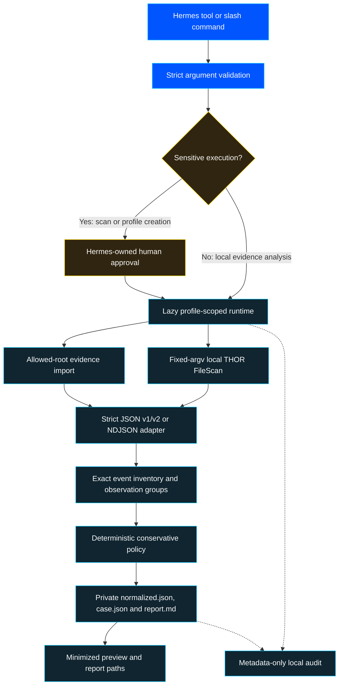

[Project overview](../README.md) / [Documentation](README.md) / Architecture

# Architecture

The native Hermes entrypoint registers eight tools, one `pre_tool_call` hook, four slash commands and the shipped namespaced skills. It performs no network or data-directory I/O at registration. It uses only documented `ctx` operations and the public `plugins.plugin_storage.plugin_data_dir` helper ([Hermes plugin API](https://hermes-agent.nousresearch.com/docs/developer-guide/plugins)).

## Data flow

The diagram describes the normal host-mediated path, not an authorization guarantee for direct Python calls. `/thor-scan` is preview-only; scan execution must enter through the normal tool pipeline.

No LLM decides severity. No external connector is active by default. Workflow YAML files guide agents and reviewers but are not advertised as an executable runner. Root portable `plugin.json`/`mcp.json` files are omitted to avoid accidental MCP launches or duplicate skill namespaces.

## Trust boundaries

| Boundary | Control | Limitation |
|---|---|---|
| Hermes → plugin | Public registration API, strict schema and host approval | Fully trusted plugins and direct library calls are outside the approval boundary |
| Filesystem → evidence engine | Canonical allowed roots, credential-file refusal and bounded imports | Not an OS sandbox or a complete acquisition/custody system |
| Plugin → THOR | Operator-selected executable, fixed argv, minimal environment and timeout | No vendor-binary sandbox or real licensed scan validation in this build |
| Reports → model context | Minimized preview and private output paths | Hermes may send tool output to its configured provider |
| Future remote integrations | Proposed server-side read-only RBAC and tenant isolation | No verified live remote connector exists yet |

Read [SECURITY.md](../SECURITY.md) for the full threat boundary and the [operator guide](OPERATOR-GUIDE.md) for deployment controls.

## Module ownership

- **api:** Strict finite tool schema subset and host approval directive, with no model-controlled shell flags.
- **security:** Canonical path containment, best-effort minimisation and structural authorization-scope checks.
- **tools/thor:** Strict structured import, explicit version rejection, exact counts and verified local FileScan invocation.
- **scoring:** Conservative provisional policy, evidence limits and case rendering.
- **runtime:** Operator configuration, private staged report publication, lazy salt and lifecycle audit with explicit post-operation audit-failure semantics.
- **tools/capabilities:** Offline inventory separating implemented functions, planned technology coverage and unverified configuration presence.
- **templates/skills:** Extensible role and technology inventory; generated mechanically from reviewable definitions.

## Compatibility and deliberate limits

Hermes v0.23.1 is the declared minimum, with integration validation against the inspected upstream revision recorded in VALIDATION.md. The actual vendor scanner is external and version-probed through its own CLI help. JSON v3 is explicitly unsupported because it is structurally distinct ([Nextron JSON versions](https://github.com/NextronSystems/jsonlog)).

The same-host/scan/file+hash identity is conservative observation grouping, not complete forensic event correlation. Records with no stable artifact key remain separate. Human analysts validate suspicious behavior, potential duplicates, attack time, priority and business impact.
