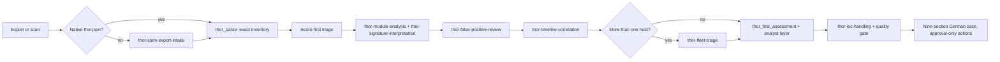

[Project overview](../README.md) / [Documentation](README.md) / THOR analysis suite

# THOR analysis suite

**From scanner output to a defensible compromise assessment.**

THOR is built to miss nothing, so it reports anomalies and false positives by design. The value of an analysis lies in deciding, with evidence, which observations matter and what they do and do not prove. The THOR analysis suite gives Hermes that discipline as nine skills, distilled from CyStrat's SOC and incident-response practice and grounded in Nextron's public [THOR Manual](https://thor-manual.nextron-systems.com/en/latest/) and [THOR Log Analysis Manual](https://log-analysis-manual.nextron-systems.com/en/latest/).

The skills are guidance for the agent, not new tools. Counting, normalisation and the first assessment remain the job of the deterministic plugin tools (`thor_parse`, `thor_first_assessment`), so numbers never depend on the model.

## The nine skills

| Skill | Purpose | Reference files |
|---|---|---|
| `thor-assessment` | Lead skill: end-to-end workflow from intake to nine-section German case, with tool layer and analyst layer kept apart | Case output template, quality gate, worked example |
| `thor-lite` | Prepare and request a bounded local THOR Lite FileScan through Hermes approval; state Lite's coverage limits | — |
| `thor-siem-export-intake` | Bring Splunk, Elastic or CSV exports into analysable form, reconcile row counts, document filters and duplicates | — |
| `thor-module-analysis` | Interpret findings per module: what Filescan, ProcessCheck, SHIMCache, AmCache, ServiceCheck, Autoruns, Registry, Eventlog and others actually prove | Module guide, file path checks, hash checks |
| `thor-signature-interpretation` | Read scores, levels, reasons and rule prefixes (MAL, HKTL, WEBSHELL, EXPL, VULN, SUSP, PUA) at their real weight | — |
| `thor-false-positive-review` | Decide true positive, authorised activity, suspicious, inconclusive or false positive, with a written reason; draft suppression filters | False-positive pattern catalogue |
| `thor-timeline-correlation` | Merge multi-source observations into findings; keep detection, artefact and source-event time apart | Timestamp semantics |
| `thor-fleet-triage` | Prevalence, outliers, coverage comparison and deltas across many hosts and scans | — |
| `thor-ioc-handling` | Extract and share indicators safely: no credential material, disclosure approval before lookups, defanging, TLP, behaviour-based ATT&CK | — |

Hermes serves each skill and its reference files through `skill_view`; the profile installer copies them into new profiles.

## How the skills work together



## Principles every skill enforces

- **Exact numbers.** Events are counted by tools, never by reading. Events, automatic observation groups and analyst findings are reported separately.
- **Evidence labels.** Every claim is Confirmed, Strong Indicator or Not Derivable.
- **Coverage honesty.** THOR Lite has no Registry, Eventlog, SHIMCache or Sigma scanning ([THOR Lite](https://www.nextron-systems.com/thor-lite/)); filters, lookback and scan modes reduce coverage further. Missing findings never prove a clean host.
- **Classic errors blocked.** No execution from SHIMCache alone, no owner-as-executing-user, no detection time as attack time, no AV action name as successful removal, no attribution from a rule name.
- **Two layers.** The deterministic Tool-Erstbewertung stays visible; the analyst's assessment adds evidence-backed changes on top.
- **Data protection.** No passwords or credential hashes in any output; pseudonymised identifiers in normalised data; external lookups only with data-sharing approval; no uploads.
- **Human control.** Containment, blocking, filter changes and tickets are drafts that require approval.

## Worked example

`examples/analysis/thor-multimodule.json` is a synthetic export with seven events across six modules. It shows why analysis matters beyond the score:

- The tool reports **7 events and 7 automatic groups**. The analyst arrives at **6 findings**, because a SHIMCache entry without a hash describes the same file as a Filescan alert. The tool correctly refuses to merge them automatically; the analyst merges them with a stated reason.
- The **highest-scoring alert is the most likely false positive**: a generic in-memory signature inside a security product's process.
- `modified` earlier than `created` on the hack-tool file is **typical for copied files** and is not, by itself, timestomping.

```bash
python -m agentic_soc assess "$(pwd)/examples/analysis/thor-multimodule.json" --output /tmp/thor-example
```

The regression suite runs the real tools on this file and checks that the numbers in the worked example still match.

## Which profiles use the suite

| Profile | THOR skills |
|---|---|
| `dfir-compromise-assessment` | All nine, plus incident response |
| `soc-l1-triage` | `thor-assessment`, `thor-false-positive-review`, `thor-siem-export-intake` |
| `soc-l2-incident-responder` | `thor-assessment`, `thor-timeline-correlation`, `thor-ioc-handling` |
| `threat-hunter` | `thor-fleet-triage`, `thor-signature-interpretation`, `thor-ioc-handling` |
| `detection-engineer` | `thor-signature-interpretation`, `thor-false-positive-review` |
| `vulnerability-manager` | `thor-module-analysis`, `thor-signature-interpretation` |
| `purple-team-validator` (gated preview) | `thor-signature-interpretation` |

## Limits

- The skills improve how Hermes reasons about THOR output. They do not add parsing support: THOR JSON v3, text logs and the legacy three-column CSV remain unsupported by the deterministic tools.
- Behavioural quality depends on the model Hermes runs. The suite has been validated structurally and against the real tools; it has not yet been evaluated against real customer cases or a licensed THOR Enterprise run.
- Module guidance follows Nextron's public documentation. Field names vary between THOR versions and output formats; check the actual export.
